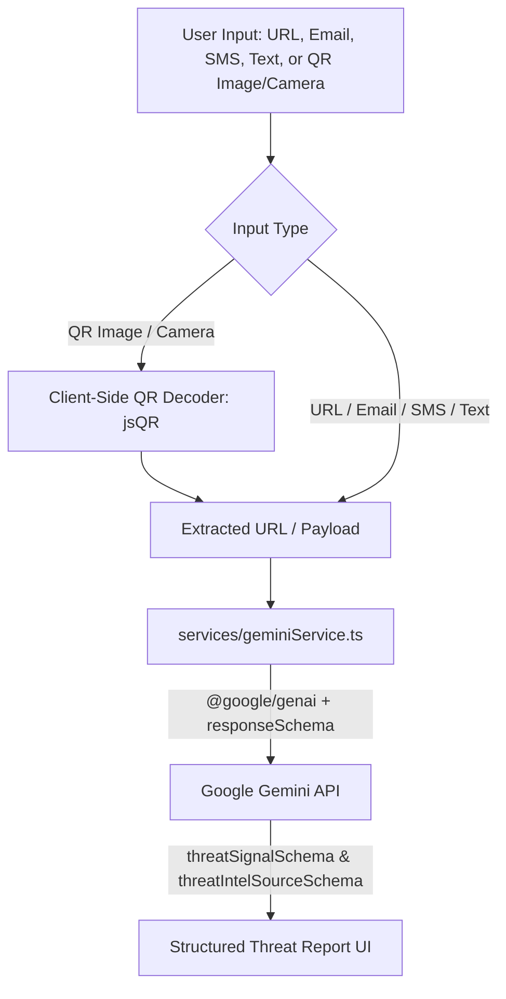

# PhishGuard AI

**Client-side React & TypeScript phishing and QR-code URL threat analyzer powered by `jsQR` and Google Gemini (`@google/genai`).**

PhishGuard AI helps users inspect suspicious URLs, QR codes (quishing), email bodies, SMS messages (smishing), and raw text in real time directly in the browser.

## Overview: Phishing & QR-Based Threats

Modern phishing attacks increasingly bypass traditional email filters using:
- **Quishing (QR-code phishing):** Malicious URLs embedded in QR codes on invoices, posters, or emails that hide the destination domain until scanned.
- **URL Obfuscation & Homoglyph Attacks:** Lookalike domains, URL shorteners, and misleading subdomains designed to impersonate trusted brands.
- **Social Engineering (Email / SMS):** Urgent or deceptive language crafted to pressure users into revealing credentials or financial details.

PhishGuard AI decodes QR code images locally in the browser using `jsQR` and sends extracted payloads or user-submitted URLs/text to Google Gemini for structured threat evaluation.

## Architecture

PhishGuard AI is a **100% client-side single-page application** built with **React 19**, **TypeScript**, and **Vite**—there is no Node.js or Express backend server.



### AI Analysis (`services/geminiService.ts`)

`services/geminiService.ts` uses `GoogleGenAI` from `@google/genai` with a strict JSON `responseSchema` to return consistent, explainable threat assessments:
- **`threatSignalSchema`**: Captures individual threat indicators (`title`, `description`, and `severity`: `info` | `warning` | `critical`).
- **`threatIntelSourceSchema`**: Captures threat intelligence source checks (`source` and `status`: `CLEAN` | `SUSPICIOUS` | `MALICIOUS` | `UNKNOWN`).
- Supports multi-vector classification across `QR`, `URL`, `Email`, `SMS`, and `Text` inputs.

## Tech Stack & Dependencies

### Runtime Dependencies
- `react` (`^19.1.1`) & `react-dom` (`^19.1.1`) — Client-side UI
- `@google/genai` (`^1.20.0`) — Google Gemini SDK
- `jsQR` — Client-side QR code decoding from uploaded images or camera frames

### Development Dependencies
- `typescript` (`~5.8.2`)
- `vite` (`^6.2.0`) & `@vitejs/plugin-react` (`^5.0.0`)
- `@types/node` (`^22.14.0`)

## Installation & Local Development

1. **Clone the repository:**
   ```bash
   git clone https://github.com/23H51A62B9/PhishGuard-AI-QR-URL-Threat-Detection
   cd PhishGuard-AI-QR-URL-Threat-Detection
   ```

2. **Install dependencies:**
   ```bash
   npm ci
   ```

3. **Configure environment variables:**
   Copy `.env.example` to `.env.local` and add your Google Gemini API key:
   ```bash
   cp .env.example .env.local
   ```
   ```env
   GEMINI_API_KEY=your_gemini_api_key_here
   ```

4. **Start the development server:**
   ```bash
   npm run dev
   ```

## Testing & Verification

Run TypeScript type checking and a production build locally:

```bash
npx tsc --noEmit
npm run build
```

## Security Note on Client-Side API Key Bundling

Because this application runs entirely in the browser and `vite.config.ts` injects `GEMINI_API_KEY` at build time via Vite's `define` configuration, **the API key is bundled into the client-side JavaScript output**.
- Do **not** deploy a public production build with an unrestricted or billing-critical Gemini API key.
- Restrict your API key in Google Cloud / Google AI Studio (e.g., HTTP referrer restrictions and quota limits), or proxy requests through a dedicated backend service before public deployment.

## Disclaimer

PhishGuard AI is an educational and assistive threat-analysis tool. **It cannot detect every phishing attack or guarantee 100% accuracy.** Always verify suspicious links, senders, and QR code destinations independently before entering credentials or sensitive information.

## License

This project is licensed under the MIT License — see the [LICENSE](LICENSE) file for details.
[](https://github.com/)
[](https://github.com/your-username/phishguard-ai)

**A full-stack, AI-powered phishing detection and prevention system designed to analyze URLs, QR codes, emails, and SMS messages for modern cyber threats in real-time.**

 <!-- Replace with a real screenshot of your app -->

## 🚀 Key Features

-   **Multi-Vector Threat Analysis**: Scans URLs, QR code content, email bodies, and SMS messages for phishing indicators.
-   **Advanced AI Detection**: Leverages Google's Gemini model to identify sophisticated threats, including social engineering tactics, URL obfuscation, homoglyph attacks, and AI-generated phishing text.
-   **Secure Backend API**: All AI analysis is handled by a secure Node.js/Express backend, protecting API keys and centralizing logic.
-   **Interactive Dashboard**: Presents a detailed analysis report with an overall risk score, actionable prevention advice, and an "Explainable AI" breakdown of detected threat signals.
-   **QR Code Scanning**: Supports both uploading a QR code image and scanning one in real-time using the device camera.
-   **User Feedback Loop**: Allows users to provide feedback on analysis accuracy, creating a data foundation for future model retraining.

## 🛠️ Tech Stack

-   **Frontend**: React, Vite, TypeScript, Tailwind CSS
-   **Backend**: Node.js, Express, TypeScript
-   **AI Engine**: Google Gemini API (`@google/genai`)
-   **QR Decoding**: `jsQR` (Client-side)
-   **Database** (Optional): MongoDB with Mongoose for storing analysis history.

## 🏛️ Architecture

The application follows a secure client-server model. The React frontend is responsible for the user interface and capturing input, while the Node.js backend handles all sensitive operations, including communication with the Gemini API.

```
[User's Browser (React Client)]
      |
      |-- (1. Sends content/QR for analysis) -->
      |
[Backend Server (Node.js/Express)]
      |
      |-- (2. Validates request) -->
      |-- (3. Calls Gemini API with secure key) --> [Google Gemini API]
      |-- (4. Receives structured JSON analysis) --<
      |
      |-- (5. (Optional) Saves result to DB) --> [MongoDB]
      |
      |-- (6. Returns JSON report to client) --<
      |
[User's Browser (React Client)]
      |
      |-- (7. Displays interactive dashboard)
```

## 🏁 Getting Started

Follow these instructions to get a local copy of PhishGuard AI up and running for development and testing.

### Prerequisites

-   Node.js (v18 or later)
-   npm or yarn

### Installation

1.  **Clone the repository:**
    ```bash
    git clone https://github.com/your-username/phishguard-ai.git
    cd phishguard-ai
    ```

2.  **Setup the Backend:**
    ```bash
    cd server
    npm install

    # Create a .env file in the /server directory
    cp .env.example .env
    ```
    Now, open `server/.env` and add your environment variables:
    ```env
    # Port for the backend server
    PORT=3001

    # Your Google Gemini API Key (keep this secret!)
    GEMINI_API_KEY=your_gemini_api_key_here

    # (Optional) Connection string for your MongoDB database
    # MONGO_URI=mongodb://...
    ```

3.  **Setup the Frontend:**
    ```bash
    cd ../client
    npm install

    # Create a .env.local file in the /client directory
    cp .env.example .env.local
    ```
    Open `client/.env.local` and configure the backend API URL:
    ```env
    # URL of your running backend server
    VITE_API_URL=http://localhost:3001
    ```

### Running the Application

1.  **Start the backend server:**
    ```bash
    # From the /server directory
    npm run dev
    ```
    The server should now be running on `http://localhost:3001`.

2.  **Start the frontend client:**
    ```bash
    # From the /client directory
    npm run dev
    ```
    Open your browser and navigate to the URL provided by Vite (usually `http://localhost:5173`).

## ⚙️ API Endpoints

The backend exposes the following REST API endpoint:

#### `POST /api/analyze`

Analyzes the content provided in the request body.

-   **Request Body**:
    ```json
    {
      "content": "The string to be analyzed (e.g., URL, email text)"
    }
    ```
-   **Success Response (200 OK)**:
    -   Returns a structured JSON `AnalysisReport` object with the full results.
-   **Error Response (400/500)**:
    -   Returns a JSON object with an error message.

## 🤝 Contributing

Contributions are welcome! If you have suggestions for improving PhishGuard AI, please feel free to fork the repository and submit a pull request.

1.  Fork the Project
2.  Create your Feature Branch (`git checkout -b feature/AmazingFeature`)
3.  Commit your Changes (`git commit -m 'Add some AmazingFeature'`)
4.  Push to the Branch (`git push origin feature/AmazingFeature`)
5.  Open a Pull Request

## 📜 License

This project is distributed under the MIT License. See `LICENSE` for more information.
`
